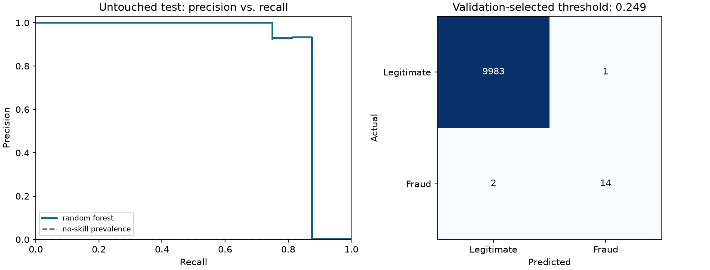

# Credit Card Fraud Detection — reproducible results

Detect fraudulent transactions using the anonymized Worldline/ULB benchmark. This run evaluates 50,000 unique transactions. The default bundled input is a deterministic, prevalence-preserving 50,000-row sample of the deduplicated public dataset. Time orders the split and is excluded from model features. See `data/README.md` for attribution and sampling details.

## Evaluation design

Seed 42. Training, validation, and test row counts: 30,000,
10,000, 10,000.
Preprocessing is fitted inside the training pipeline. Model selection uses validation
average_precision; the decision threshold maximizes validation F2.
The selected model is **random_forest**. No tuning uses the test labels.

## Untouched test results

| Measure | Selected model | Constant-prevalence baseline |
|---|---:|---:|
| Average precision | 0.8666 | 0.0016 |
| ROC AUC | 0.9334 | 0.5000 |
| Log loss (lower is better) | 0.0073 | 0.0119 |
| Brier score (lower is better) | 0.0004 | 0.0016 |
| Precision | 0.9333 | 0.0000 |
| Recall | 0.8750 | 0.0000 |
| F1 | 0.9032 | 0.0000 |
| Accuracy | 0.9997 | 0.9984 |

At threshold **0.2495**, the model produces **15** positive flags:
**14** true positives and **1** false positives.
It misses **2** positives; **9,983** negatives are correctly rejected.
Test positive prevalence is **0.16%**, across 10,000 rows.

## Interpretation and limits

Average precision and fraud recall are more useful here than accuracy: predicting every transaction as legitimate already achieves very high accuracy. F2 threshold selection weights recall more than precision, but false alerts still consume investigation effort. The test partition covers later transactions, and the small number of fraud cases limits precision of the estimated recall. The benchmark spans only two days in 2013; its anonymized PCA features prevent business-level explanations. These are sample benchmark results, not production fraud-prevention guarantees.

See [all candidate metrics](metrics.csv), [auditable test predictions](predictions.csv),
[split assignments](splits.csv), and [run metadata, input hash, and package versions](metrics.json).
Numbers here are generated by the script, not copied from the historical notebook.
