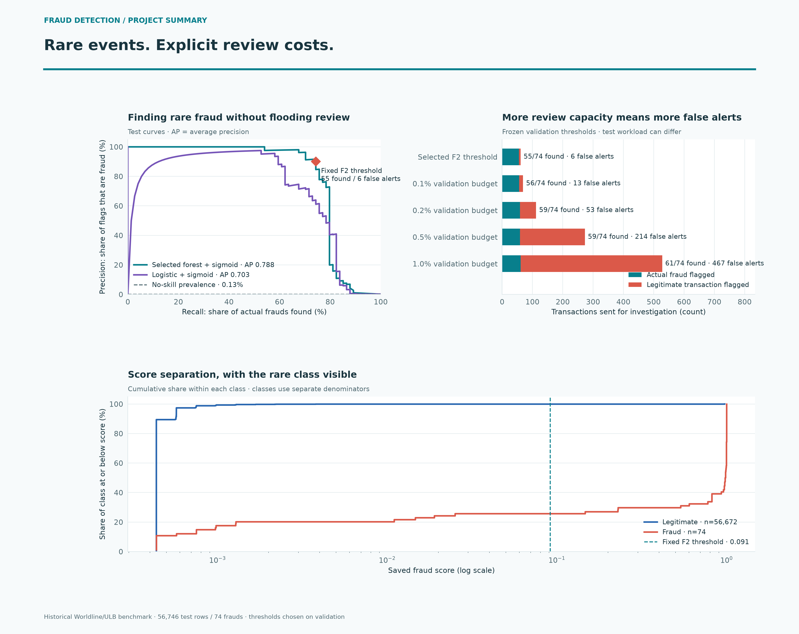
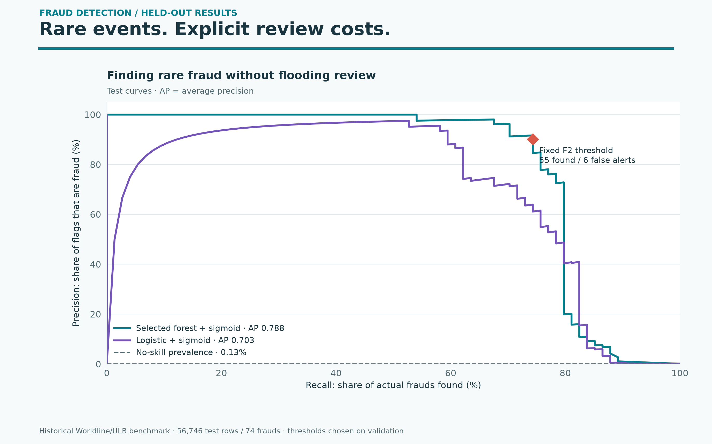
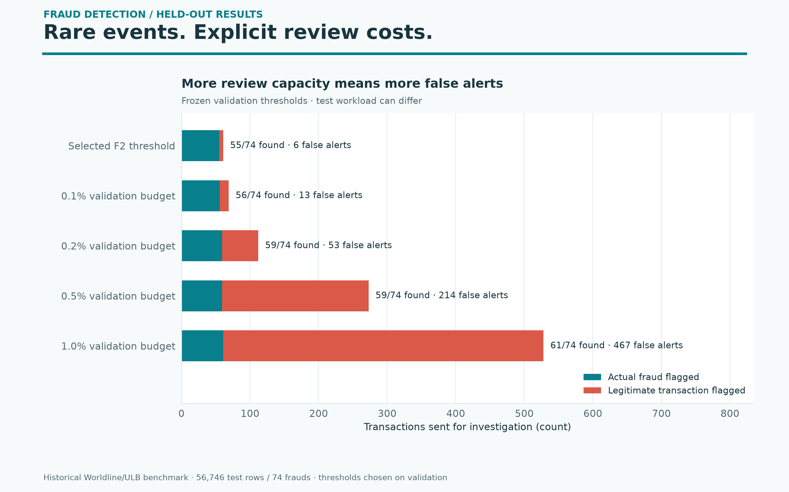
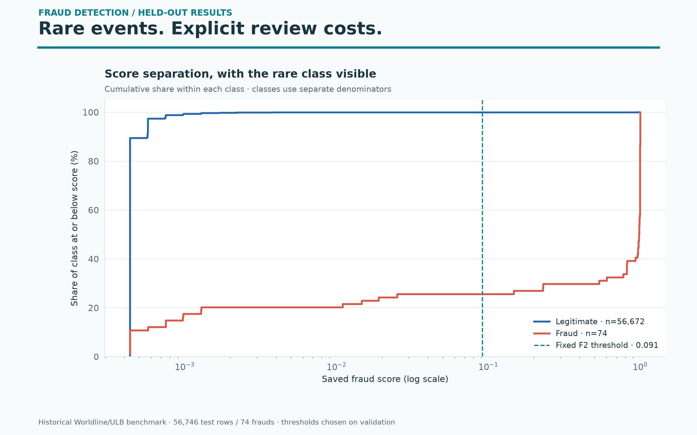

# Fraud detection — colorful results gallery

Rare events. Explicit review costs.

Historical Worldline/ULB benchmark · 56,746 test rows / 74 frauds · thresholds chosen on validation



High-resolution PNGs and editable SVGs come from saved phase-two results. No model was retrained and no data was downloaded. These are descriptive benchmark results; model and policy choices were fixed on validation.

## Fraud Precision Recall

Precision–recall is more informative than accuracy for this rare-event benchmark. The marked threshold is fixed from validation F2.



[PNG](fraud_precision_recall.png) · [SVG](fraud_precision_recall.svg)

## Fraud Review Budget

Budget percentages are validation targets, not guarantees of test capacity. The F2 threshold is a separate operating choice. Only the four lowest documented budgets are shown.



[PNG](fraud_review_budget.png) · [SVG](fraud_review_budget.svg)

## Fraud Score Distribution

Each class has its own denominator; this does not show population prevalence. Score is on a log axis. Up to 1,800 ordered points per class show the ECDF; endpoints are retained.



[PNG](fraud_score_distribution.png) · [SVG](fraud_score_distribution.svg)

## Reproduce

```bash
python plot_gallery.py
```

Use the pinned project requirements. Sources and hashes are in [chart-provenance.json](chart-provenance.json). Original phase-two outputs are unchanged.
